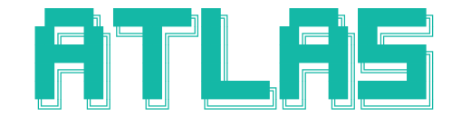

<div align="center">



<br/>

**Research as a graph.**

Connect ideas, experiments, evidence, and results.<br/>
Keep the revisions and the reasoning that led you there.

<br/>

[](https://www.npmjs.com/package/@synsci/atlas)
[](LICENSE)

[Website](https://tryatlas.sh) · [CLI](cli/README.md) · [SDK](sdk/README.md) · [Graph UI](ui/README.md) · [Contributing](CONTRIBUTING.md)

</div>

<br/>

## What it is

Atlas is a research graph engine with a command line, an HTTP API, a JavaScript
SDK, and a React graph UI. A project holds the question; connected nodes hold
the work, evidence, and results. Revisions preserve how that work changed.

```text
                         research question
                                │
                    ┌───────────┴───────────┐
                    │                       │
                hypothesis               evidence
                    │                       │
               experiment ──────────────── source
                    │
                  result
                    │
              next question ...
```

- **Keep the context.** Link research nodes, attach evidence, record runs, and
  follow the graph back to the work that produced a result.
- **Make changes traceable.** Stage edits, commit revisions, pin repository
  state, and retain an audit history.
- **Work from your tools.** Use the CLI in a terminal or script, call the API
  through the SDK, or embed the graph UI in your application.
- **Run locally.** The standalone server uses SQLite by default and supports
  PostgreSQL with pgvector. Graph rules do not require a Dashboard checkout.

Atlas supplies the graph. [OpenScience](https://github.com/synthetic-sciences/OpenScience)
is the research agent and workbench. Synthetic Sciences' hosted Dashboard owns
accounts, organizations, Wallet, and managed providers.

## Install

```sh
npm install --global @synsci/atlas
atlas --help
```

Or run the CLI without a global installation:

```sh
npx @synsci/atlas --help
```

Use `atlas login` for a hosted account, or connect it to a local graph server.
The [CLI guide](cli/README.md) covers configuration. The CLI installs no agent
skills, hooks, or agent configuration.

## Your first local graph

From a source checkout, start the server:

```sh
uv sync --project backend --frozen --extra pg
uv run --project backend atlas-graph --port 8002
```

In another terminal:

```sh
export ATLAS_BASE_URL=http://127.0.0.1:8002/api/v1
export ATLAS_API_KEY=local

atlas project:create --title "My research"
atlas project:list
```

Local mode accepts loopback connections. SQLite data lives in `data/` unless
you set `ATLAS_DATA_DIR`; `ATLAS_LOCAL_TOKEN` replaces the local development
token. Hosted deployments use an explicit identity adapter and signing secret.
Public graph discovery is disabled by default.

## Build on Atlas

| Package | Use it for |
| --- | --- |
| [`@synsci/atlas`](https://www.npmjs.com/package/@synsci/atlas) | Graph commands, scripting, and hosted client workflows |
| [`@synsci/atlas-sdk`](https://www.npmjs.com/package/@synsci/atlas-sdk) | JavaScript and TypeScript clients, with no runtime dependencies |
| [`@synsci/atlas-ui`](https://www.npmjs.com/package/@synsci/atlas-ui) | React 19 graph views, nodes, evidence, revisions, and sharing |

```js
import { AtlasClient } from "@synsci/atlas-sdk";

const atlas = new AtlasClient({
  baseUrl: "http://127.0.0.1:8002/api/v1",
  token: "local",
});

const project = await atlas.createProject({ title: "My research" });
const graph = await atlas.getNode(project.project_id);
```

The [SDK guide](sdk/README.md) covers requests and errors. The
[UI guide](ui/README.md) covers styles, themes, and host adapters.

## Repository

```text
backend/    Graph engine, HTTP API, storage, permissions, revisions, indexing
cli/        Terminal client and command contracts
sdk/        JavaScript client and TypeScript declarations
ui/         React graph components, styles, and host integration
landing/    tryatlas.sh
docs/       Architecture, development, and release records
```

Start with [CONTRIBUTING.md](CONTRIBUTING.md) for setup and checks,
[architecture](docs/architecture.md) for the boundaries, and
[server configuration](docs/development.md) for local and hosted settings.
[AGENTS.md](AGENTS.md) records repository conventions. Pull requests are squash
merged after their required checks pass.

The npm packages are public. Source access is currently limited to repository
collaborators; this repository remains private. Hosted service migration is
tracked separately in [service separation](docs/service-separation.md).

## Contributing and security

Bug fixes, reproducible reports, API and CLI improvements, and clearer
documentation are welcome. Start with the [contribution guide](CONTRIBUTING.md).
Participation follows our [Code of Conduct](CODE_OF_CONDUCT.md).

Report vulnerabilities privately using [SECURITY.md](SECURITY.md). Account,
billing, and credential details belong in private support channels.

## License

Apache License 2.0. See [LICENSE](LICENSE) and [NOTICE](NOTICE).

Copyright 2026 InkVell Inc. (dba Synthetic Sciences).<br/>
Contact: [support@sayntheticsciences.ai](mailto:support@sayntheticsciences.ai).
